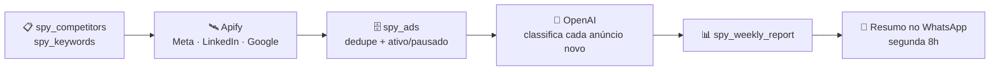

# 🕵️ Espião de Anúncios

Monitora toda semana os anúncios que os concorrentes estão rodando na **Meta** (Facebook e Instagram), no **LinkedIn** e no **Google** (Search, YouTube e Display). A IA classifica cada anúncio novo e, na segunda de manhã, chega no WhatsApp um resumo com o que mudou, o que está durando e ideias de anúncio para a sua empresa.

Roda em **n8n + Supabase**, com coleta pelo **Apify** e análise pela **OpenAI**.



## O que entra no resumo

- Números da semana, com anúncios ativos, novos e pausados por plataforma
- O que cada concorrente mudou
- Os anúncios ativos há mais tempo (quem paga desliga o que não converte, então os que duram tendem a ser os que funcionam)
- As dores, ofertas e formatos que mais aparecem
- De 3 a 5 ideias de anúncio adaptadas à sua empresa
- Anunciantes novos achados pelas palavras-chave do nicho

## O que a IA anota em cada anúncio

| Campo | Exemplos |
|:--|:--|
| Formato | imagem, carrossel, vídeo, texto, documento |
| Dor | segurança, LGPD, custo de TI, parada, falta de equipe, nuvem, Microsoft 365, backup |
| Oferta | diagnóstico grátis, material rico, webinar, demo, orçamento, teste grátis |
| Funil | topo, meio, fundo |
| Gancho, ângulo, CTA, destino | texto livre e categorias |
| Prova | números, cases, depoimento, certificações, logos de clientes |
| Público, tom, estilo visual | texto livre e categorias |
| Nota de inspiração | 1 a 5 |
| Ideia para nós | uma ideia de anúncio adaptada, sem copiar o concorrente |

Fica tudo em `spy_ads.analysis` (JSON), e dá para filtrar direto no Supabase.

## Custo estimado

Com 40 concorrentes e 10 palavras-chave, uma coleta por semana:

| Item | Preço | Semana |
|:--|:--|:--|
| Meta (`jmlp/meta-ad-library-scraper`) | ~US$ 0,19 por mil anúncios | centavos |
| LinkedIn (`alexmorain/linkedin-ad-library-scraper`) | US$ 2 por mil com detalhes | ~US$ 1 |
| Google (`scrapesage/google-ads-transparency-scraper`) | US$ 2 a 4 por mil | ~US$ 2 a 3 |
| OpenAI (`gpt-5-mini` por anúncio, `gpt-5` no resumo) | ~US$ 0,003 por anúncio | ~US$ 0,50 |

Isso dá algo entre **US$ 10 e 20 por mês**. O plano gratuito do Apify dá US$ 5 de crédito mensal, então ele cobre os testes e uma lista menor. Para a lista completa toda semana, vale um plano pago ou cortar concorrentes. Cada coleta tem teto de US$ 0,50 (`max_charge_usd_per_job`), e no Apify dá para definir um limite mensal em **Settings → Usage & billing**.

## Setup

### 1. Supabase

1. No SQL Editor, rode [`supabase/001_schema.sql`](supabase/001_schema.sql).
2. Copie [`supabase/002_seed.example.sql`](supabase/002_seed.example.sql) para `002_seed.local.sql`, coloque seus concorrentes e palavras-chave e rode também.
3. Em **Settings → API Keys**, crie ou copie uma **secret key** (`sb_secret_...`).

Todas as tabelas têm o prefixo `spy_` e RLS ligado, então só a secret key enxerga os dados.

### 2. Apify

1. Crie a conta em [apify.com](https://apify.com).
2. Em **Settings → API & Integrations**, copie o token pessoal.
3. Defina um limite de gasto mensal em **Settings → Usage & billing**.

### 3. OpenAI

Crie uma chave em [platform.openai.com/api-keys](https://platform.openai.com/api-keys), de preferência num projeto separado e com limite mensal.

### 4. n8n

Publique os workflows de um destes dois jeitos.

- **Script** (cria as credenciais com valores provisórios e os dois workflows, desativados)
  ```bash
  cp config.example.json config.local.json   # preencha
  N8N_API_KEY=... npm run deploy -- --create-credentials
  ```
- **Importação manual** de [`n8n/workflows/collect.json`](n8n/workflows/collect.json) e [`n8n/workflows/digest.json`](n8n/workflows/digest.json), depois ajuste o nó **Config** de cada um e escolha as credenciais nos nós HTTP.

Depois, em **Credentials** no n8n, troque o valor provisório de cada uma pela chave real.

| Credencial | Tipo | O que colar |
|:--|:--|:--|
| Espião · Supabase | Custom Auth | `{"headers":{"apikey":"sb_secret_..."}}`. Se você só tiver a chave antiga `service_role` (começa com `eyJ`), acrescente `"Authorization":"Bearer eyJ..."` |
| Espião · Apify | Header Auth | nome `Authorization`, valor `Bearer apify_api_...` |
| Espião · OpenAI | OpenAI | a chave `sk-...` |

Cada credencial fica travada no domínio da sua API, então não vaza para outro serviço.

No nó **Config** do workflow 2, preencha `company_context` (quanto mais específico, melhores as ideias) e `digest_numbers` (os WhatsApp que recebem o resumo).

### 5. Teste e ative

1. Abra **Espião de Anúncios · 1. Coleta semanal** e clique em **Executar workflow**. Com 40 concorrentes leva de 20 a 40 minutos.
2. Confira `spy_runs` e `spy_run_jobs` no Supabase. Coleta com falha aparece com `ok = false` e o erro.
3. Execute **Espião de Anúncios · 2. Análise e resumo**. Na primeira semana pode haver mais anúncios do que o `analysis_limit`. Rode de novo até zerar a fila, ou aumente o limite.
4. Ative os dois workflows. A coleta roda segunda às 5h e o resumo às 8h (horário de Brasília).

## Uso no dia a dia

- **Concorrentes** ficam em `spy_competitors`. Para parar de monitorar um, marque `active = false`. Os campos `facebook_url`, `linkedin_slug` e `domain` são opcionais e cada um liga uma plataforma.
- **Palavras-chave** ficam em `spy_keywords`. Elas acham anunciantes que ainda não estão na lista, e o resumo traz esses nomes em *Anunciantes novos no radar*.
- **Histórico** fica em `spy_ads` (todos os anúncios) e na view `spy_ads_view` (com `days_running` e o nome do concorrente).

## Como o sistema decide que um anúncio parou

Um anúncio que some da biblioteca é marcado como pausado (`is_active = false`, `stopped_at`). Para não perder dados por causa de uma coleta ruim, o sistema não pausa nada quando a coleta falhou, quando bateu o limite de anúncios por concorrente ou quando veio parcial. Uma coleta vazia só pausa os anúncios se a coleta anterior do mesmo concorrente também veio vazia.

## Limitações

- Nenhuma biblioteca mostra quanto o concorrente gasta fora da União Europeia. O tempo no ar é o melhor sinal disponível.
- O LinkedIn só publica datas e impressões de anúncios exibidos na UE. Para o Brasil, o tempo no ar conta a partir da primeira vez que o espião viu o anúncio.
- A API oficial da Meta não devolve anúncios comerciais exibidos só no Brasil, por isso a coleta usa a biblioteca pública via Apify.
- Os links de imagem da Meta expiram em alguns dias. A análise roda no mesmo dia da coleta para pegar a imagem válida.

## Desenvolvimento

O código dos nós Code fica em [`n8n/src`](n8n/src) e é testado fora do n8n. O build monta os workflows a partir dele.

```bash
npm install
npm test          # testes de JS e do SQL (Postgres em memória com PGlite)
npm run build     # gera n8n/workflows/*.json (modelos públicos, sem dados reais)
npm run deploy    # publica no n8n usando config.local.json
```

`config.local.json` e `supabase/*.local.sql` ficam fora do git. É neles que vão URLs, números e a lista de concorrentes.
